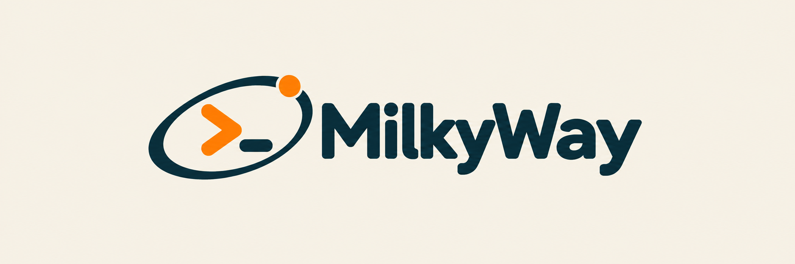

<picture>
  <source media="(prefers-color-scheme: dark)" srcset="docs/assets/milkyway-dark.png">
  
</picture>

# MilkyWay

A framework for provisioning and configuring a professional self-hosted homelab, built around Proxmox, Tailscale, Authentik, OpenBao, Komodo, and observability.

**Status:** repository foundation is available. [Read-only host preflight](docs/proxmox-preflight.md) is available. Baseline changes and service deployment follow after the installation handoff.

Run `make setup` to install development tools and hooks, then `make check`. See [development](docs/development.md) and [releases](docs/releases.md).

- [Foundation plan](docs/foundation-plan.md)
- [Brand assets](docs/branding.md)
